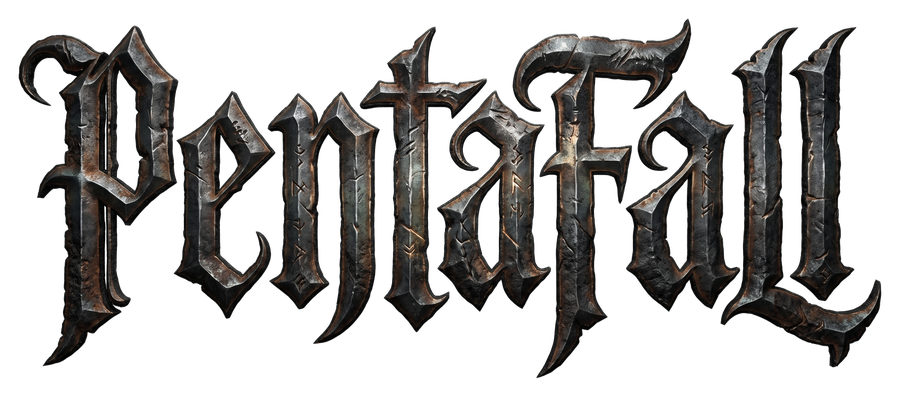
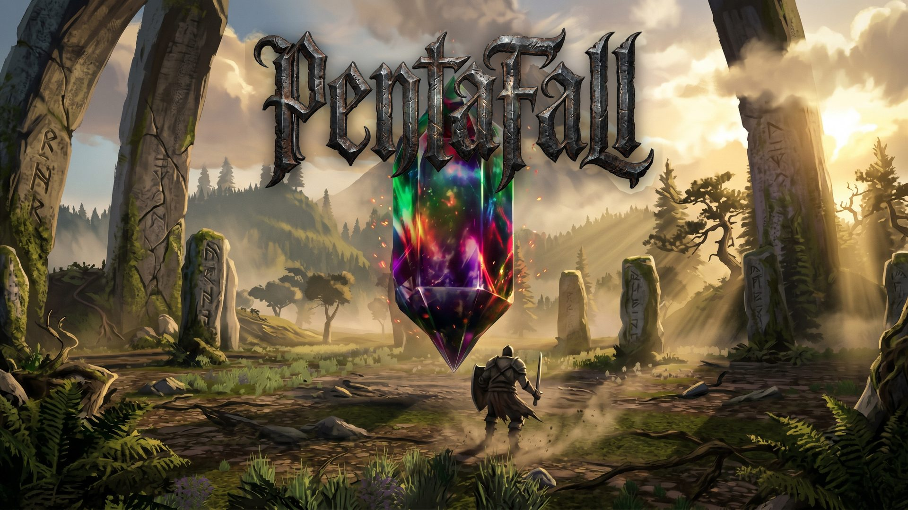
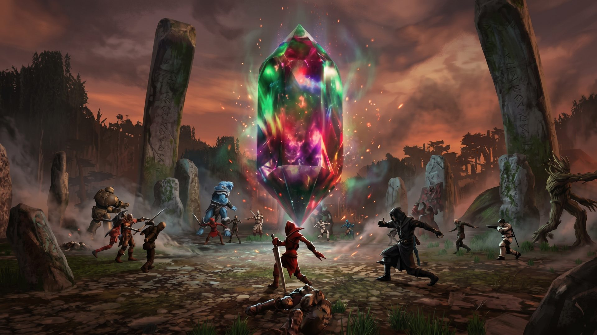
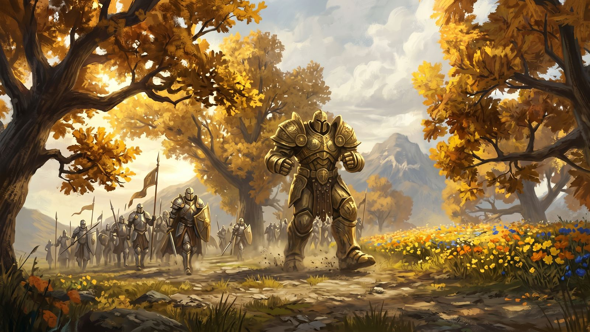
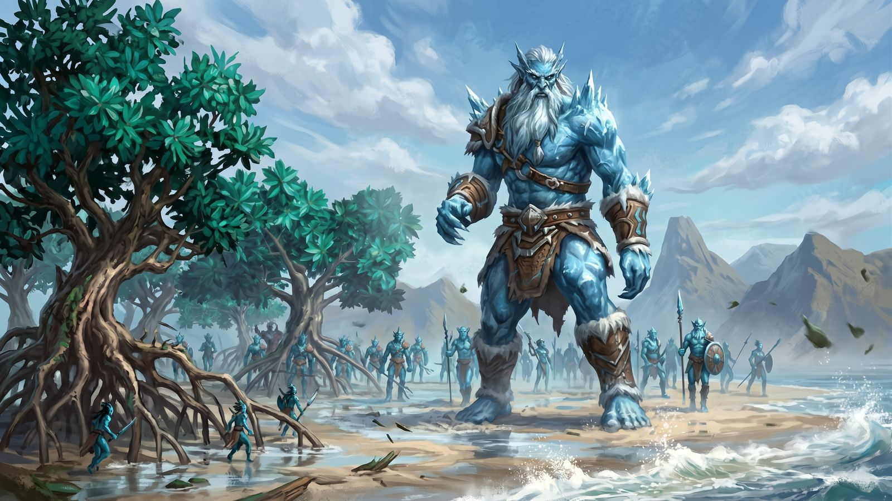
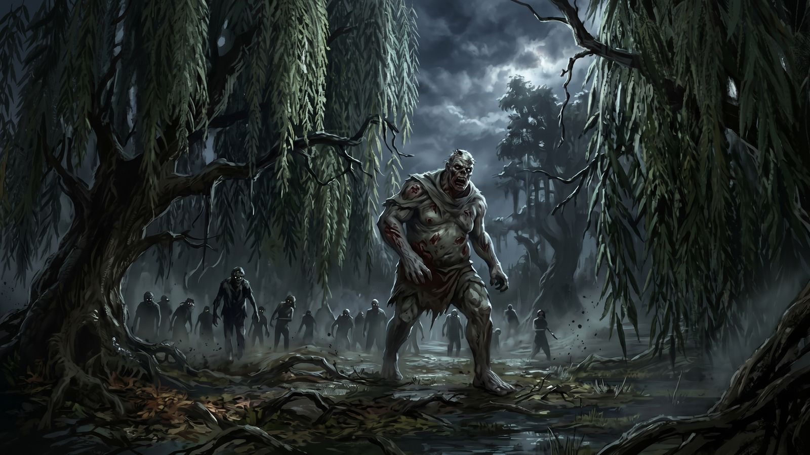
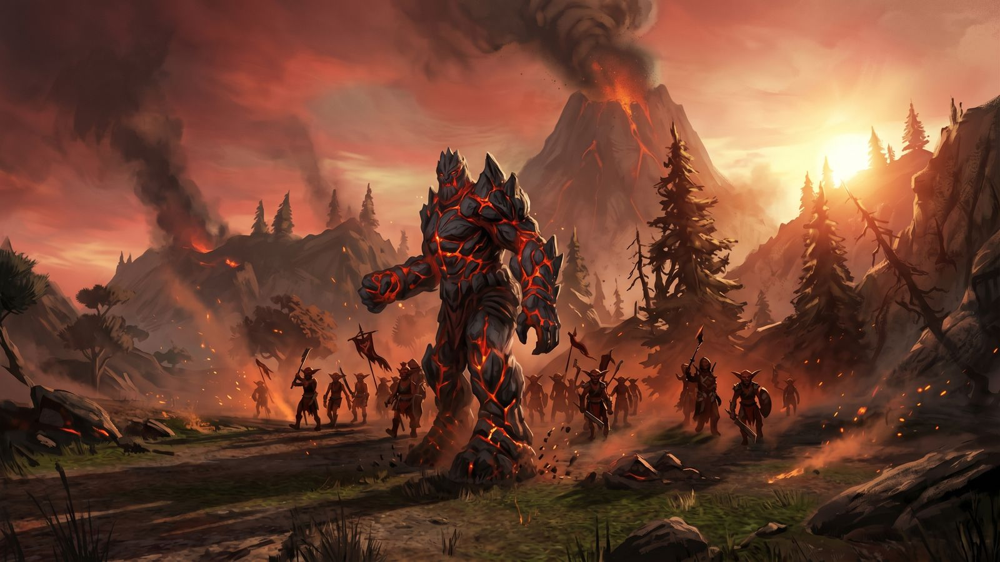
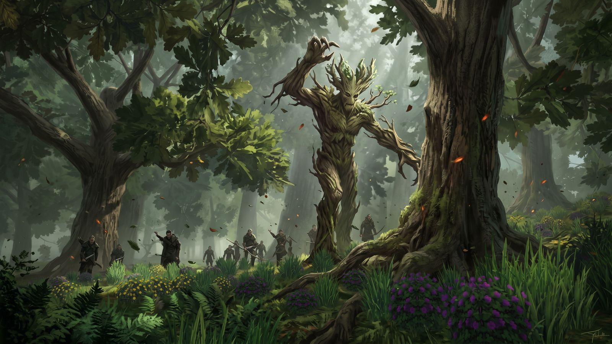
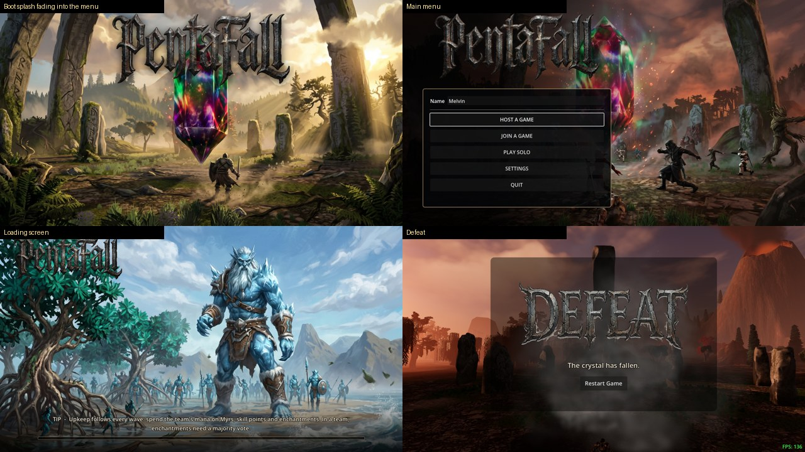
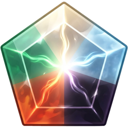

<p align="center">
  
</p>

<p align="center">
  <b>Five colours. Five lanes. One crystal.</b><br>
  A co-op action tower defense for up to five players, built in Godot 4.
</p>

<p align="center">
  <a href="https://github.com/marvinrunge/pentafall/releases/latest"></a>
  
  
</p>



## The game

A crystal stands at the centre of a pentagon. Five lanes lead to it, one for each colour
of mana: **White, Blue, Black, Red and Green**. They follow the colour wheel, so every
lane borders its two allies. Each wave the colours march their warbands down the lanes.
Melee screens hold the front, archers form a shell behind them and mages cast from the
core. Neighbouring colours can arrive together and charge as one.

You fight in third person with your weapon and the spells of the colours you choose.
Everyone in the party levels at the same time. Between waves the team spends its shared
mana at Upkeep. If the crystal falls, the run is over.

<p align="center">
  
</p>

## Features

- **Co-op for one to five players.** Host a game, join one, or play solo. With five
  players, each one usually holds the lane of their own colour.
- **Thirty skills across five colours.** Each colour has five active spells and two auras,
  and every skill has five ranks. Wrath of God, Frost Breath, Doom Blade, Fireball,
  Giant Growth and more.
- **Guild synergies.** Invest in two neighbouring colours to unlock that pair's guild
  node, such as Azorius, Dimir or Rakdos. Each one links how the two colours play.
- **Shared economy.** XP and levels belong to the whole team, so nobody can steal a kill.
  Skill points are yours to spend. Mana belongs to the team and pays for Myrs,
  enchantments and extra skill points at Upkeep. In a team, enchantments need a majority
  vote.
- **Myrs.** Little workers that harvest the mana wells for you. Build them at the base
  beside the crystal.
- **A boss every fifth wave.** The Paladin, Frost Giant, Zombie Lord, Fire Giant and
  Treant each fight in three phases. Every attack is marked on the ground before it
  lands, and bosses drop equipment for the whole team.
- **Day and night.** A full sky cycle. Nights are dark on purpose: you see by the
  crystal's light, torches and your own spells.

## The five colours

Each colour has its own biome, its own warband and its own boss. The loading screen
shows whichever one is coming.

<table>
  <tr>
    <td width="50%"><br><b>White</b>: golden groves, a holy host and the Paladin.</td>
    <td width="50%"><br><b>Blue</b>: mangrove coasts, the tide's soldiers and the Frost Giant.</td>
  </tr>
  <tr>
    <td><br><b>Black</b>: drowned willow swamps, the restless dead and the Zombie Lord.</td>
    <td><br><b>Red</b>: volcanic slopes, goblin hordes and the Fire Giant.</td>
  </tr>
  <tr>
    <td colspan="2" align="center"><br><b>Green</b>: old-growth forest, its wild beasts and the Treant.</td>
  </tr>
</table>

## In game



## Controls

| Action | Keyboard & mouse | Gamepad (Xbox layout) |
|---|---|---|
| Move · Look | `W A S D` · Mouse | Left stick · Right stick |
| Attack | Left mouse | `RT` |
| Block (hold) | Right mouse | `LT` |
| Kick | `F` | `R3` |
| Cast a spell | `1`–`8` pick and cast a slot, `Q` casts the selected one | `A` `B` `X` `Y` slots 1–4, `RB` + the same for 5–8 |
| Cycle spells | Mouse wheel | D-pad ← → |
| Jump · Sprint | `Space` · `Shift` | `LB` · push the stick fully |
| Interact (hold at a mana well) | `E` | D-pad ↑ |
| Skill tree · Equipment | `P` · `I` | hold `L3`, pick from the wheel |
| Wave info | `Tab` | `View` |

The in-game hints always name the button for the device you're holding.

## Playing

**Windows:** download `Pentafall-windows.zip` from the
[latest release](https://github.com/marvinrunge/pentafall/releases/latest),
unzip it and run `Pentafall.exe`. Keep the DLLs next to the `.exe`. The build is
unsigned, so Windows SmartScreen will warn you on first launch. Click
*More info → Run anyway*.

**From source:** open `project.godot` in **Godot 4.7** (Forward+) and press Play. The
terrain (TerraBrush) and WebRTC addons are included in `addons/`.

## Project layout

```
scenes/        Godot scenes: main map, UI, enemies, player
scripts/       GDScript: gameplay, networking, UI, spells, waves
assets/        Models, animations, textures, sound, music, UI art
docs/          Design documents (waves, economy, skills, bosses, multiplayer…)
tools/         Validation, asset pipelines and tests
site/          The project website (GitHub Pages)
```

The design documents in [`docs/`](docs) explain the reasoning behind each system:
[waves](docs/WAVE_DESIGN.md), [economy](docs/ECONOMY.md), [skills](docs/SKILL_DESIGN.md),
[bosses](docs/BOSS_DESIGN.md) and [multiplayer](docs/MULTIPLAYER_PLAN.md).
[RELEASING.md](docs/RELEASING.md) covers how a build is published.

---

<p align="center">
  <br>
  <sub>Pentafall is unofficial Fan Content permitted under the Fan Content Policy. Not
  approved/endorsed by Wizards. Portions of the materials used are property of Wizards of
  the Coast. ©Wizards of the Coast LLC.</sub>
</p>
